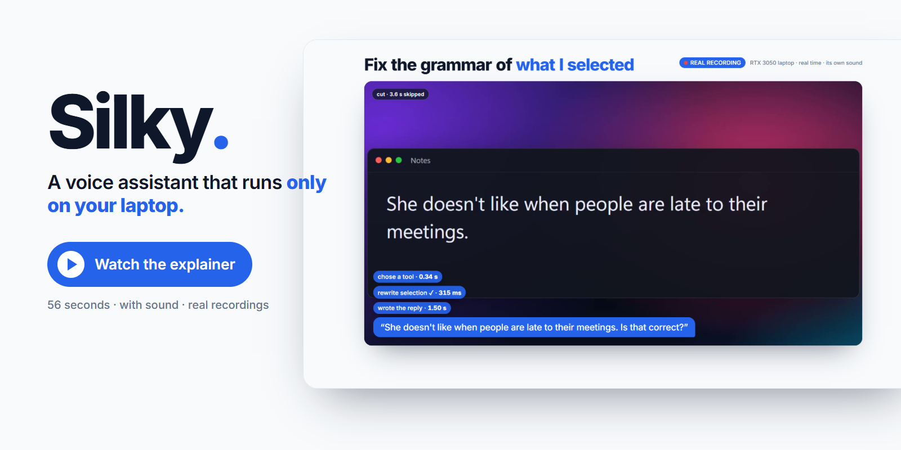
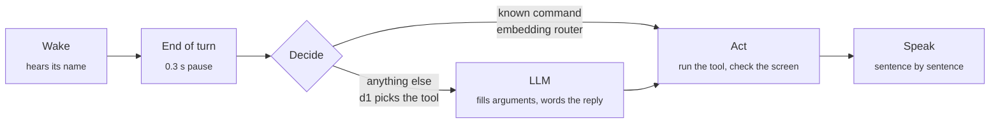

<div align="center">

# Silky

**A voice assistant that lives on your Windows laptop and runs entirely on it.**<br>
Say its name, say what you want, and local models do it.

No account · No subscription · Nothing leaves your laptop

[](docs/silky-explainer.mp4)

<sub>[The explainer](docs/silky-explainer.mp4) (56 s, with sound) includes two real, unsped recordings of Silky answering
spoken commands on an RTX 3050 laptop with 4 GB of VRAM. [film/explainer](film/explainer/README.md) has the sources and
says exactly what is recorded and what is illustrated.</sub>

</div>

---

## What it does

| | Say something like | What happens |
|---|---|---|
| **Your selection** | "fix the grammar of this", "make this formal", "shorten this" | The selected text is rewritten in place |
| **Files by meaning** | "find my notes about op-amps", "where is my internship offer letter" | Matches appear as a card; click one to open it |
| **The screen** | "is there an error on my screen?", "tell me when the download finishes" | It looks, answers, or waits and tells you |
| **Reminders** | "set a 10 minute timer", "at 6 pm remind me to call mom" | Reminders survive a restart |
| **Memory** | "remember that my bike lock code is 4172", "what is my bike lock code" | Kept as a plain file under `data/` |
| **Apps and the web** | "open the calculator", "open youtube", "search the web for ..." | After opening, it checks the app really appeared |
| **The machine** | "what time is it", "how is my battery", "volume up", "lock the screen" | Known commands run instantly, with no LLM |
| **Clipboard** | "summarize what I copied", "copy that to my clipboard" | |

It answers out loud while a small overlay in the top-right corner shows what it is doing:

| Listening | Speaking | Found files (click to open) |
|---|---|---|
|  |  |  |

## Quick start

You need **Windows 10 or 11**, a microphone and about **10 GB** of free disk (mostly models). A GPU helps a lot but is not required.

**1 · Set up the inference kit** ([llama-swap-kit](https://github.com/chaoticrs/llama-swap-kit): the models and the engines that run them), if you have not already:
```powershell
git clone https://github.com/chaoticrs/llama-swap-kit
cd llama-swap-kit
powershell -ExecutionPolicy Bypass -File scripts\setup.ps1
cd ..
```

**2 · Set up Silky** in a folder next to it:
```powershell
git clone https://github.com/chaoticrs/silky
cd silky
powershell -ExecutionPolicy Bypass -File setup.ps1       # Python environment, wake-word and end-of-turn models (26 MB)
powershell -ExecutionPolicy Bypass -File setup-kit.ps1   # recommended: three extra models for the kit (1.6 GB)
```

**3 · Check, then run:**
```powershell
.\run.ps1 --doctor    # lists what is in place and how to fix what is not
.\run.ps1             # starts the kit if needed, then the assistant
```

Say **"Silky"**, then your command, in one breath or two. Say the name again while it talks to interrupt it.
After a reply it keeps listening for a few seconds, so follow-ups need no wake word.

> [!NOTE]
> `setup-kit.ps1` is optional. Without it Silky still works, but known commands are not instant, and there is no
> file search by meaning, no memory and no looking at the screen.

<details>
<summary>More ways to run it</summary>

```powershell
.\run.ps1 --text "open notepad"   # typed command, no microphone
.\run.ps1 --text "..." --mute     # no speech either
.\run.ps1 --index                 # build or update the file-search index and exit
```
</details>

## How a command is handled



1. **Wake.** What you say is transcribed and checked for the name (`wake.engine = "transcript"`: reliable for any name, uses the CPU while someone talks). `"spotter"` is a tiny always-on keyword model: almost free, but it often misses unusual names.
2. **End of turn.** A small audio model judges that you have finished after a 0.3 s pause, instead of waiting out a fixed 0.8 s.
3. **Decide.** Known commands are matched by embedding against [routes.toml](routes.toml) and run at once, with no LLM. Otherwise a decision model (d1) picks the tool without generating text, and the LLM only fills in the arguments and words the reply.
4. **Act and check.** Risky tools ask first. Tools that should change the screen are verified by looking at it.
5. **Speak.** Sentence by sentence, so the first words come before the reply is complete.

| Measured on the laptop | |
|---|---|
| A command it knows | **under 0.1 s** (embedding router, no LLM) |
| Choosing the right tool | **under 0.5 s** (d1 decision model) |
| LLM and d1 loaded together | **about 3.6 GB**, on a 4 GB laptop GPU |

The overlay shows each step's time as it happens (`stt .91 · decide .11 · reply .64`) and a chip per tool call
(green = worked, amber = failed). Short tones tell you it woke, heard you, or has news.

## Configure

Everything is in [config.toml](config.toml): the assistant's name and wake phrase, which kit roles to use,
how patient to be, which features are on (`cues`, `memory`, `search`, `decide`, `sight`), and how careful the tools are:

| `tools.policy` | Behaviour |
|---|---|
| `confirm` *(default)* | Risky tools (`delete_file`, `run_powershell`, `forget`) ask "Should I ...?" and need a spoken yes |
| `auto` | Nothing asks |
| `readonly` | Risky tools are not offered to the model at all |

- **Rename it:** change `assistant.name` and `wake.phrase`.
- **Add an instant command:** add a `[[route]]` to [routes.toml](routes.toml).
- **Add a tool:** see [ARCHITECTURE.md](ARCHITECTURE.md).

<details>
<summary>What it needs from the kit</summary>

| Kit role or model | Used for | Where it comes from |
|---|---|---|
| `agent` | the LLM: any model that can call tools | the kit's own setup |
| `stt`, `tts` | hearing and speaking | the kit's own setup |
| `stt-command` | the same speech-to-text model, tuned for short English commands (about 6x faster here) | `setup-kit.ps1` |
| `embed` | instant commands, file search, memory | `setup-kit.ps1` |
| `d1` | choosing tools, the screen ([LiquidAI d1-2B](https://huggingface.co/LiquidAI/d1-2B-GGUF); needs llama.cpp build 11960 or newer) | `setup-kit.ps1` |

Anything missing from the last three is reported at start, and the features built on it switch themselves off.

**On a 4 GB graphics card** the LLM and d1 only stay loaded together if both are small. `setup-kit.ps1` gives d1
small buffers and a fixed memory budget for this; the agent model then has to fit in what is left (about 1.9 GB:
a 4-bit model of up to roughly 2B parameters). If the two do not fit, the kit swaps them on every step, which
is slow: use a smaller agent model or set `decide.enabled = false`. If the LLM has a thinking mode,
`kit.request` in the config switches it off. On battery, laptop GPUs can run several times slower.
</details>

## Limits worth knowing

- Windows only. Speech recognition is tuned for English.
- Measured on one machine (i5-12500H, RTX 3050 Laptop 4 GB, 16 GB RAM) and tested with synthesized speech, not yet with many real voices, rooms or microphones.
- The screen model judges coarse things (is this app open, is there a dialog) and cannot read small text.
- A small LLM occasionally calls a tool it did not need, or words an answer oddly. The decision model in front of it removes most wrong tool choices, not all.

## Develop

```powershell
.venv\Scripts\python.exe -m tests.test_contracts   # contract tests: every brick against fakes, no kit needed
```
How it is built and how to extend it: [ARCHITECTURE.md](ARCHITECTURE.md). The explainer's sources are in [film/explainer](film/explainer/README.md).

## Credits and licence

MIT, see [LICENSE](LICENSE). Built on other people's work, each under its own licence:
[llama-swap](https://github.com/mostlygeek/llama-swap), llama.cpp and whisper.cpp (through the kit);
[sherpa-onnx](https://github.com/k2-fsa/sherpa-onnx) (wake word);
[Smart Turn](https://github.com/pipecat-ai/smart-turn) by Pipecat (end of turn, BSD-2-Clause);
[d1](https://huggingface.co/LiquidAI/d1-2B) by Liquid AI (LFM Open License) and
[bge-small](https://huggingface.co/BAAI/bge-small-en-v1.5) by BAAI. Models are downloaded by the setup scripts,
not shipped in this repository.
